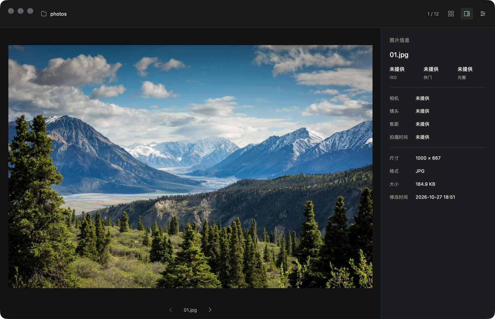

# 见山 · 图片查看器

[](https://github.com/ch1y1z1/jianshan/actions/workflows/ci.yml)

从 [Releases](https://github.com/ch1y1z1/jianshan/releases/latest) 下载 macOS（Apple Silicon / Intel）、Windows x64 和 Linux x64 安装包。应用内可通过「见山 → 检查更新」或「工具 → 检查更新」获取新版。

基于 Go + MyGo Native UI 的首版实现位于 [app/](app/README.md)，前期交互原型保留在 `prototype/`。

原生版默认是极简单图视图与右侧照片信息栏；网格顶部只有一条窄工具栏，排序、格式、搜索和 ISO 筛选在「工具」中展开。已实现真实文件浏览、常见位图预览、RAW 内嵌 JPEG/系统预览、标准 EXIF、11 种排序及按需解码。

```sh
cd app
mise exec go@1.27.3 -- go run . /path/to/photos
```



详细运行、构建、测试和当前限制见 [app/README.md](app/README.md)，版本发布与签名更新约定见 [RELEASING.md](RELEASING.md)。macOS 包目前使用临时签名，尚未接入 Apple Developer ID 签名与公证；Windows 包尚无代码签名证书，系统首次打开时可能提示。

- `app/`：原生实现、测试、构建配置及真实窗口截图。
- `prototype/`：用于前期讨论的浏览器交互原型；照片参数与 RAW 后缀为模拟数据。
- `DESIGN.md`：原始调研与交互设计。
- `photo-viewer-research.html`：调研可视化速览。

浏览器原型预览：在本目录运行 `node serve-preview.mjs`，访问 http://127.0.0.1:5192/prototype/ 。该预览与原生应用是两个独立入口。
